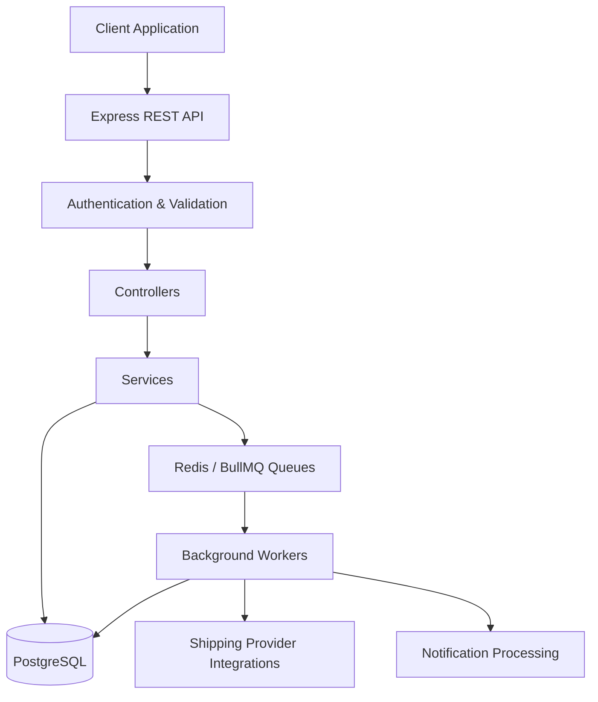
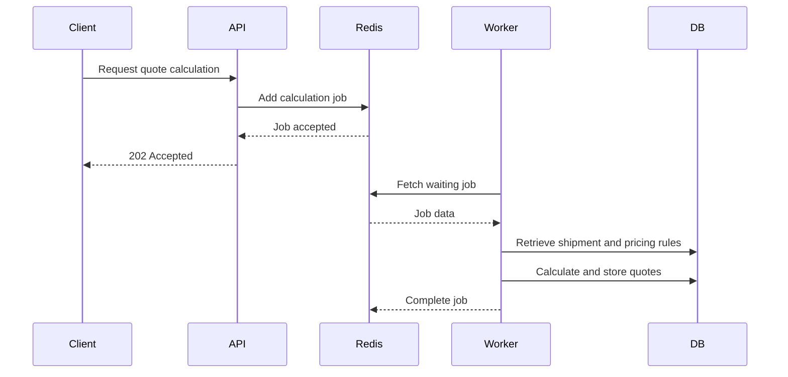

# 🚀 Shipping Aggregator
### A Scalable Backend Platform for Multi-Provider Shipping Management

**Shipping Aggregator** is a backend platform designed to simplify and optimize the shipping process by connecting multiple shipping providers through a unified system.

Instead of integrating with each shipping company separately, the platform provides a centralized solution for managing shipments, comparing delivery rates, tracking shipment progress, and handling notifications.

Built with **Node.js, Express.js, PostgreSQL, Prisma ORM, Redis, and BullMQ**, the system focuses on clean architecture, efficient data management, asynchronous processing, and scalability.

---

## ✨ Core Features

### 📦 Shipment Management
- Create and manage shipping requests.
- Store sender and receiver information.
- Manage shipment dimensions, weight, and shipping type.
- Track shipment status throughout its lifecycle.
- Maintain shipment-related events and history.

### 💰 Intelligent Shipping Quote Engine
- Calculate chargeable weight using actual and volumetric weight.
- Compare shipping rates from multiple providers.
- Apply provider-specific pricing rules.
- Support base prices, per-kilogram rates, and additional surcharges.
- Automatically exclude inactive providers and invalid pricing rules.
- Store generated quotes with expiration dates.
- Sort available offers by price to help users choose the most suitable provider.

### 🚚 Multi-Provider Integration Architecture
- Centralized integration with multiple shipping providers.
- Provider abstraction to avoid tightly coupling business logic to individual shipping APIs.
- Factory-based provider selection.
- Designed to support providers such as Aramex, DHL, and FedEx.
- Extensible architecture that makes adding new shipping providers easier.

### ⚡ Background Processing with Redis & BullMQ
Time-consuming operations are designed to run asynchronously without blocking the main API request lifecycle.

- Redis-powered job queues.
- Dedicated workers for shipment processing, quote calculation, and notifications.
- Configurable job retry attempts.
- Exponential backoff strategy for failed jobs.
- Job concurrency management.
- Completed and failed job retention policies.

### 🔔 Notification Management
- Create and store user notifications.
- Process notification creation through background workers.
- Retrieve user notifications.
- Mark notifications as read.
- Separate background processing from notification retrieval and management.

### 📍 Shipment Tracking
- Maintain shipment tracking events.
- Record shipment status updates.
- Provide shipment progress history.
- Keep tracking information associated with each shipment.

### 🔐 Authentication & Authorization
- Protected API endpoints.
- User authentication.
- Role-based access control.
- Separate administrative operations from regular user operations.

---

## 🏗️ System Architecture

The application follows a modular backend architecture that separates API handling, business logic, data persistence, and asynchronous job processing.



### Background Job Processing Flow



**Why this architecture?**

The API does not need to wait for every background operation to finish. It can accept the request and delegate time-consuming work to dedicated workers.

This improves request responsiveness and provides a structured way to handle retries, failures, and concurrent background tasks.

---

## 🛠️ Technology Stack

| Technology | Purpose |
|---|---|
| Node.js | JavaScript runtime |
| Express.js | REST API framework |
| PostgreSQL | Relational database |
| Prisma ORM | Database access and data modeling |
| Redis | In-memory data store and queue infrastructure |
| BullMQ | Background job processing |
| ioredis | Redis client |
| Docker | Containerized infrastructure |
| JavaScript (ES Modules) | Application development |

---

## 🧠 Engineering Highlights

This project focuses on practical backend engineering concepts:

- **Modular Architecture:** Separating responsibilities across controllers, services, queues, workers, and provider integrations.
- **Asynchronous Processing:** Moving time-consuming tasks out of the HTTP request-response cycle.
- **Database Relationships:** Modeling users, addresses, shipments, providers, quotes, tracking events, and notifications.
- **Dynamic Pricing:** Calculating shipping costs using configurable provider pricing rules.
- **Scalable Job Processing:** Using Redis and BullMQ to manage background workloads.
- **Error Handling:** Handling application errors and failed background jobs.
- **Extensibility:** Designing provider integrations so additional shipping companies can be introduced without rewriting the core business logic.

---

## 📂 Project Structure

```text
src/
│
├── config/
│   ├── prisma.js
│   └── redis.js
│
├── modules/
│   ├── Auth/
│   ├── Shipment/
│   ├── Quote/
│   ├── Provider/
│   ├── Tracking/
│   └── Notification/
│
├── queues/
│   ├── queue.config.js
│   ├── shipment.queue.js
│   ├── quote.queue.js
│   └── notification.queue.js
│
├── workers/
│   ├── shipment.worker.js
│   ├── quote.worker.js
│   └── notification.worker.js
│
├── integrations/
│   ├── base/
│   ├── aramex/
│   ├── dhl/
│   └── fedex/
│
├── middlewares/
├── utils/
└── app.js
```

---

## ⚙️ Getting Started

### Prerequisites

Make sure you have the following installed:

- Node.js
- PostgreSQL
- Docker
- Redis

### 1. Clone the Repository

```bash
git clone <YOUR_REPOSITORY_URL>
cd Shipping-Aggregator/backend
```

### 2. Install Dependencies

```bash
npm install
```

### 3. Configure Environment Variables

Create your environment configuration file and provide the required database, authentication, and Redis configuration.

```env
DATABASE_URL=your_database_connection_string
JWT_SECRET=your_jwt_secret
REDIS_HOST=127.0.0.1
REDIS_PORT=6379
```

Add any additional variables required by your application and shipping provider integrations.

### 4. Start Redis

```bash
docker run -d \
  --name redis \
  -p 6379:6379 \
  redis:latest
```

### 5. Start the API Server

```bash
npm start
```

### 6. Start Background Workers

Run workers in separate terminal sessions:

```bash
node src/workers/quote.worker.js
```

```bash
node src/workers/shipment.worker.js
```

```bash
node src/workers/notification.worker.js
```

---

## 🔄 How the Platform Works

1. A user creates a shipment by providing sender, receiver, and package information.
2. The system stores the shipment and its related information in PostgreSQL.
3. Quote calculation can be submitted as a background job.
4. BullMQ stores the job in Redis.
5. The quote worker processes the job and calculates available shipping offers.
6. Generated quotes are stored in PostgreSQL.
7. The user retrieves and compares available shipping offers.
8. Shipment tracking events and notifications help maintain visibility throughout the shipping process.

---

## 🎯 Project Goals

The main goal of Shipping Aggregator is to demonstrate how a modern backend system can bring multiple shipping services together through a unified, maintainable, and extensible architecture.

The project emphasizes more than basic CRUD operations: it explores real-world backend challenges such as dynamic pricing, relational data modeling, provider abstraction, asynchronous processing, queue management, and system scalability.

---

## 👨‍💻 Developer

**Backend Engineering | Node.js | Express.js | PostgreSQL | Prisma | Redis | BullMQ**

Built with a focus on clean code, maintainable architecture, and practical backend engineering principles.

---

⭐ If you find this project interesting, feel free to explore the repository and follow its development.
